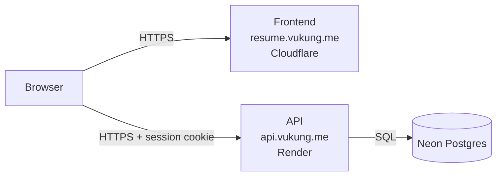

# Resume Rocket

A resume builder with a live side-by-side preview and one-click PDF download.

**Live app:** https://resume.vukung.me (no signup needed: click "Try a demo with a sample resume" on the login page)

## Why I built this

My college uses a placement management portal, Pod.ai, where students build a resume once and reuse it across placement drives. While using it I could never see what the finished resume would actually look like: no preview of the layout, no sense of how many pages it would run to, no view of where the bullet points land, and no way to check how it would look printed.

Resume Rocket is my attempt at that missing piece. You type on the left and the resume updates on the right as you type, and you can download the real PDF at any time. The downloaded PDF shows the true page breaks. Page break guides inside the live preview are planned but not built yet.

## What it does

- Accounts with signup, login and logout
- Up to 20 resumes per account: create, rename, duplicate, search and delete (with a confirmation)
- A side-by-side editor with seven collapsible sections: Basics, Summary, Education, Skills, Experience, Projects, Certifications
- An info icon next to each field with guidance on what to write
- Add, remove (with a 6 second Undo), and move up or down for every list entry
- Chip inputs for skills and tech stacks, bullet editing with Enter and Backspace shortcuts, month and year dropdowns, and percentage or CGPA grades with validation and a hint when a percentage looks like a CGPA
- Autosave: 1.5 seconds after you stop typing, never two saves at once, three automatic retries five seconds apart, and an immediate save on Ctrl+S or Cmd+S or when the tab is hidden
- A live preview rendered as semantic HTML with a standard font, designed to stay readable by applicant tracking systems
- Download PDF: a real A4 file named "Your Name - Resume.pdf" with selectable text and no browser header or footer. Ctrl+P also prints the preview.
- A responsive layout: two panels on wide screens, Edit and Preview tabs on small ones
- A temporary demo account for each visitor, with a fictional sample resume, deleted after 24 hours

## How it works




The frontend is a static single-page app. The API is a stateless Express server. Because the app and the API are on subdomains of the same domain, the browser treats them as the same site and a plain `SameSite=Lax` cookie works for login.

## Key design decisions

| Decision | Why |
|---|---|
| Each resume is one JSONB document in Postgres | A resume is edited and saved as a whole. One validated update replaces the old design of six per-section tables, which cleared and re-inserted every section on each save without a transaction |
| Strict zod validation on the server, mirrored limits on the client | The server never trusts the client, and the client sanitizes saves so a half-typed link or an out-of-range grade cannot cause a failed autosave |
| One shared resume model feeds the preview and the PDF | Section order, filtering, dates, grades and links follow the same rules in both. The two layouts are still separate, so line and page breaks can differ slightly |
| Real PDF generation, not `window.print()` | Browsers add their own date and web address to printed pages and CSS cannot remove them. `@react-pdf/renderer` is loaded only when someone clicks Download, so the main bundle stays small |
| Session in an httpOnly cookie, never `localStorage` | JavaScript cannot read the token, which limits the damage from a script injection |
| Neon instead of Supabase | The free Supabase plan pauses inactive projects after a week. Neon scales to zero but wakes on the next connection |
| Temporary per-visitor demo accounts | A recruiter gets a private sandbox in one click, with no shared data to break |

## Tech stack

| Layer | Technology |
|---|---|
| Server | Node 24, Express 5, TypeScript (strict), `pg`, `zod`, `helmet`, `cors`, `bcryptjs`, `jsonwebtoken`, `express-rate-limit` |
| Database | Postgres on Neon, with plain SQL migrations |
| Client | Vite, React, TypeScript (strict), Tailwind CSS, React Router, Sonner, Lucide icons |
| PDF | `@react-pdf/renderer` with built-in Helvetica |
| Tests | `node:test` for the server, Vitest and Testing Library for the client |
| Hosting | Render (API), Cloudflare (frontend and DNS), Neon (database) |

## Data model

- **`users`**: `id` (uuid), `email` (unique on lowercase), `name`, `password_hash`, `created_at`, `is_demo`
- **`resumes`**: `id` (uuid), `user_id` (cascade delete), `title`, `content` (JSONB), `is_deleted` (soft delete), `created_at`, `updated_at`
- **`schema_migrations`**: records which migration files have run

`content` is a versioned JSON object with `basics`, `summary`, `education`, `skills`, `experience`, `projects` and `certifications`. List items carry client-generated ids. Limits are enforced on the server: 200 KB per request, 15 bullets per entry, 40 skills per group, 20 resumes per user.

## API

| Method | Route | Purpose | Auth |
|---|---|---|---|
| GET | `/health` | Liveness check (never touches the database) | No |
| GET | `/health/db` | Database connectivity check | No |
| POST | `/api/auth/signup` | Create an account | No |
| POST | `/api/auth/login` | Log in | No |
| POST | `/api/auth/logout` | Log out | No |
| GET | `/api/auth/me` | Current user | Yes |
| POST | `/api/auth/demo` | Create a temporary demo account with a sample resume | No |
| GET | `/api/resumes` | List your resumes (`?q=` searches titles) | Yes |
| POST | `/api/resumes` | Create a resume | Yes |
| GET | `/api/resumes/:id` | Get one resume with its content | Yes |
| PATCH | `/api/resumes/:id` | Rename | Yes |
| PUT | `/api/resumes/:id/content` | Replace the content | Yes |
| POST | `/api/resumes/:id/duplicate` | Duplicate | Yes |
| DELETE | `/api/resumes/:id` | Soft delete | Yes |

## Security

- Passwords are hashed with bcrypt (cost 12). Login returns the same error for a wrong password and an unknown email, and runs a dummy comparison so response time does not reveal which emails exist.
- Every resume query filters by resume id, owner and not-deleted. Another user's resume, a random id and a malformed id all return the same 404.
- Origin check on state-changing requests, a single allowed CORS origin, `helmet`, strict input validation, parameterized SQL, and no stack traces or database errors sent to clients.
- Rate limits: 10 signups or logins per 15 minutes per IP, 5 demo sessions per hour per IP, and a per-user limit on the resume routes.
- Demo accounts use a reserved email domain, have a password nobody knows, cannot log in, expire after 24 hours, and are capped at 200 live accounts.

## Testing

- **Server:** 40 tests covering auth, the resumes API (including cross-user access), validation limits, soft delete, and the demo account lifecycle. They run against the real database named in `DATABASE_URL`, create temporary users and remove them afterwards, so point them at a database you do not mind touching.
- **Client:** 74 tests covering the API client, routing, every form input, autosave and its failure path, the resume model, the preview, printing, PDF generation (including a smoke test that produces a real PDF), and the demo flow.
- The agent that helped build this could not drive a browser, so on-screen behavior was checked by hand. There are no end-to-end browser tests.

## Running locally

**Prerequisites:** Node 24 and a free [Neon](https://neon.com) Postgres database (use the pooled connection string).

```bash
git clone https://github.com/Vukung/Resume-Builder.git
cd Resume-Builder
```

**Server**

```bash
cd server
npm install
cp .env.example .env     # on Windows PowerShell: Copy-Item .env.example .env
```

Fill in `server/.env`:

| Variable | Notes |
|---|---|
| `DATABASE_URL` | Your Neon pooled connection string |
| `JWT_SECRET` | At least 32 characters. Generate one with `node -e "console.log(require('crypto').randomBytes(48).toString('hex'))"` |
| `CLIENT_ORIGIN` | Defaults to `http://localhost:5173` |
| `PORT` | Defaults to 4000 |
| `NODE_ENV` | `development` or `production` |

```bash
npm run migrate          # creates or updates the tables, safe to run repeatedly
npm run dev              # http://localhost:4000
```

**Client** (in a second terminal)

```bash
cd client
npm install
cp .env.example .env     # sets VITE_API_URL, defaults to http://localhost:4000
npm run dev              # http://localhost:5173
```

Open the app at exactly `http://localhost:5173`. The server only accepts requests from that origin.

**Tests:** run `npm test` in `server` or in `client`.

## Deployment

- **Database:** Neon. Migrations run from your own machine, because Render does not run them. Run `npm run migrate` against the target database before deploying code that needs a schema change.
- **API on Render (free web service):** root directory `server`, build command `npm ci --include=dev && npm run build` (dev dependencies are needed for the TypeScript build), start command `npm start`, health check path `/health`. Set `NODE_ENV`, `DATABASE_URL`, `CLIENT_ORIGIN` (the exact frontend origin, with no trailing slash) and `JWT_SECRET`.
- **Frontend on Cloudflare:** built from the `client` folder with `npm run build`. `VITE_API_URL` must be set as a build-time variable, not a runtime one, because Vite bakes it into the files. If it is missing, the deployed app tries to call `localhost`.
- **Domain:** the API is a CNAME at `api.vukung.me` with Cloudflare's proxy turned off, so Render can issue its certificate and the API sees real visitor IPs for rate limiting.
- **Cold starts:** the free API server and the free database both sleep when idle. The app shows a "waking up the server" banner if a request takes more than 4 seconds.


## Roadmap

- Retry once on a transient database connection error after the free database wakes
- Dependency audit fixes, security headers and a content security policy
- Continuous integration on every push, and an uptime monitor for the API
- Page break guides and a page counter in the live preview
- More templates, JSON import and export, and dark mode
- Password reset and account deletion


Built by Utkarsh ([@Vukung](https://github.com/Vukung)).
